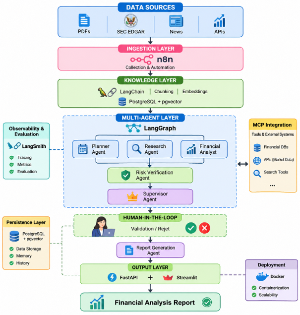

<div align="center">

# FinCopilot

**Plateforme d'analyse financière automatisée par IA agentique, RAG et validation humaine.**


</div>

---

## 📑 Sommaire

1. [Présentation](#-présentation)
2. [Fonctionnalités](#-fonctionnalités)
3. [Architecture](#-architecture)
4. [Stack technique](#-stack-technique)
5. [Les agents](#-les-agents)
6. [Serveur MCP](#-serveur-mcp)
7. [Pipeline RAG](#-pipeline-rag)
8. [Données financières et KPI](#-données-financières-et-kpi)
9. [Automatisations n8n](#-automatisations-n8n)
10. [Human-in-the-Loop](#-human-in-the-loop-hitl)
11. [Observabilité et évaluation (LangSmith)](#-observabilité-et-évaluation-langsmith)
12. [Installation](#-installation)
13. [Utilisation](#-utilisation)
14. [API](#-api)
15. [Tests](#-tests)
16. [Limites et perspectives](#-limites-et-perspectives)

---

## Présentation

**FinCopilot** automatise une grande partie du processus d'analyse financière d'une entreprise (cas d'usage actuel : **Microsoft, ticker MSFT**) :

- **Collecte** automatisée des rapports financiers SEC (10-K, 10-Q, 8-K) et des données XBRL.
- **Exploitation** de ces documents grâce à un système **RAG** (Retrieval-Augmented Generation).
- **Analyse** par plusieurs **agents IA spécialisés**, orchestrés avec LangGraph.
- **Vérification** de la fiabilité des résultats (cohérence des chiffres, sources, risques).
- **Validation humaine** (Human-in-the-Loop) lorsque l'analyse n'est pas explicitement approuvée par le Supervisor.
- **Génération** d'un rapport financier structuré au format PDF, envoyé automatiquement par email.

**Exemple de requête :** *« Analyse la situation financière de Microsoft en 2026. »*

> ⚠️ Les rapports générés sont des **brouillons d'aide à l'analyse** et ne constituent en aucun cas un conseil financier.

---

## Fonctionnalités

- 🤖 **Système multi-agents** : 6 agents spécialisés (Planner, Research, Financial Analyst, Risk Verifier, Supervisor, Report Generator).
- 🔎 **RAG sur les rapports SEC** : embeddings Qwen3, recherche sémantique multi-requêtes avec seuil de similarité et citation des sources.
- 🔌 **Serveur MCP** : les agents accèdent aux données via 3 outils standardisés.
- 🧮 **KPI fiables** : calculs déterministes en Python et SQL, avec contrôles de cohérence (jamais laissés au LLM).
- 🧑‍⚖️ **Human-in-the-Loop** : validation par lien signé à usage unique, avec journal d'audit.
- 💾 **Persistance** : les analyses en pause sont conservées dans PostgreSQL et survivent aux redémarrages.
- 🛡️ **Sécurité** : clé API, liens signés expirants, protection contre l'injection de prompt, conteneurs durcis.
- ⏰ **Automatisation** : ingestion quotidienne des données SEC, analyse hebdomadaire chaque lundi.
- 📄 **Rapports PDF** envoyés automatiquement par email.
- 🔭 **Observabilité** : traçage complet et évaluation automatique avec LangSmith.
- ✅ **95 tests pytest** : logique métier, API, sécurité et base PostgreSQL réelle.
- 🐳 **Déploiement Docker Compose** en une commande.

---

## Architecture

<p align="center">
  
</p>

Le système est organisé en couches :

| Couche | Rôle |
| --- | --- |
| **Data Sources** | PDF, SEC EDGAR, actualités, APIs |
| **Ingestion Layer** | n8n : collecte et automatisation |
| **Knowledge Layer** | LangChain (chunking, embeddings) + PostgreSQL/pgvector |
| **Multi-Agent Layer** | LangGraph : Planner, Research, Financial Analyst, Risk Verifier, Supervisor |
| **MCP Integration** | Outils et systèmes externes exposés aux agents |
| **Human-in-the-Loop** | Validation ou rejet de l'analyse |
| **Report Generation** | Rapport final structuré avec sources |
| **Output Layer** | FastAPI + Streamlit |
| **Persistence Layer** | PostgreSQL : stockage, mémoire, historique |
| **Observability** | LangSmith : tracing, métriques, évaluation |
| **Deployment** | Docker : conteneurisation |

### Rôle de chaque technologie

| Technologie | Rôle |
| --- | --- |
| **LangChain** | Composants pour les agents, le RAG et l'intégration des LLM |
| **LangGraph** | Orchestration des agents, décisions, boucles et pauses HITL |
| **MCP** | Standardise la communication entre les agents et les outils externes |
| **n8n** | Workflows externes : collecte, planification, notifications |

---

## 🧰 Stack technique

| Technologie | Responsabilité |
| --- | --- |
| Python 3.12 | Logique métier |
| LangChain | RAG et intégration LLM |
| LangGraph | Orchestration multi-agents et persistance (checkpointer PostgreSQL) |
| MCP (SDK `mcp`) | Exposition des outils aux agents |
| Groq (`openai/gpt-oss-120b`) | Modèle de langage des agents (délai maximal 90 s, 3 tentatives) |
| Qwen3-Embedding-0.6B | Embeddings (vecteurs de 1024 dimensions, GPU ou CPU) |
| n8n | Automatisation des workflows |
| PostgreSQL 17 + pgvector | Données relationnelles, mémoire, audit et vecteurs |
| FastAPI | Backend et API REST |
| Streamlit | Interface utilisateur |
| LangSmith | Observabilité et évaluation |
| fpdf2 + markdown | Génération du rapport PDF |
| Docker Compose | Déploiement |
| pytest + httpx | Tests |

---

## 🤖 Les agents

Le workflow LangGraph enchaîne les agents suivants :

| # | Agent | Responsabilités |
| --- | --- | --- |
| 1 | **Planner** | Comprend la demande, la décompose en tâches, détermine les agents et outils à mobiliser |
| 2 | **Research** | Recherche les informations (documents via RAG, APIs) et retourne les passages avec leurs sources |
| 3 | **Financial Analyst** | Analyse les données, interprète les indicateurs (croissance, marges, ROA, ROE) et les tendances |
| 4 | **Risk Verifier** | Vérifie la cohérence des chiffres, détecte les contradictions et les informations non fiables |
| 5 | **Supervisor** | Décide `APPROVED_FOR_DRAFT` ou `HUMAN_REVIEW_REQUIRED` |
| 6 | **Report Generator** | Consolide les résultats validés en un rapport structuré avec sources |

**Principes de fiabilité :**
- Les KPI sont **calculés en Python** à partir de PostgreSQL, puis fournis aux agents ; une donnée absente donne « Data not available ».
- **Sécurité par défaut** : seule une approbation explicite du Supervisor évite la validation humaine.
- Température du LLM à `0`, délai maximal et nouvelles tentatives en cas d'erreur.

---

## 🔌 Serveur MCP

Le serveur MCP (`backend/app/mcp/server.py`, port **8001**) est le pont standardisé entre les agents et les données. Il expose 3 outils :

| Outil | Description |
| --- | --- |
| `search_financial_documents` | Recherche sémantique (RAG) dans les chunks des rapports SEC |
| `get_financial_kpis` | Récupère les KPI financiers de Microsoft |
| `get_financial_history` | Consulte l'évolution historique d'un indicateur |

**Pourquoi MCP ?** Sans MCP, un agent doit connaître l'implémentation du RAG et de la base de données. Avec MCP, il appelle un outil standardisé, sans dépendre du code interne. Les outils sont convertis pour LangChain/LangGraph via `langchain-mcp-adapters`.

---

## 📚 Pipeline RAG

```
Dépôt SEC le plus récent (API submissions : 10-K, 10-Q, 8-K)
   → Extraction du texte (BeautifulSoup)
   → Découpage en chunks (1000 caractères, chevauchement 150)
   → Embeddings (Qwen3-Embedding-0.6B, 1024 dimensions)
   → Stockage PostgreSQL + pgvector (index HNSW, similarité cosinus)
   → Recherche multi-requêtes (3 angles), dédoublonnage, seuil de similarité
   → Passages présentés aux agents comme données non fiables, avec leurs sources
```

- **Ingestion en ligne de commande** : `python -m app.rag.ingest [--cik ...] [--form 10-K] [--force]` trouve le dernier dépôt, ignore un document déjà ingéré et enregistre ses métadonnées (formulaire, dates, modèle, découpage).
- **Recherche pilotée par la question** : trois requêtes (question, indicateurs financiers, risques), seuil réglable `MIN_SIMILARITY`, réponse « Data not available » si rien de pertinent.
- **Protection contre l'injection de prompt** : passages balisés comme données non fiables, texte nettoyé, passages suspects écartés.

---

## 📈 Données financières et KPI

**Sources SEC collectées** (n8n et `backend/app/services/sec_collector.py`) :

| Rapport | Contenu | Utilisation |
| --- | --- | --- |
| 10-K | Rapport annuel | Analyse financière globale |
| 10-Q | Rapport trimestriel | Suivi des performances |
| 8-K | Événements importants | Actualités réglementaires |
| XBRL | Indicateurs structurés | Calcul des ratios |

**Qualité des données :** le JSON brut est dédoublonné (hash) et chaque observation XBRL est unique. La vue `financial_analysis_annual` ne retient que les 10-K annuels : trimestres et 10-Q sont exclus.

**KPI calculés** (`backend/app/services/financial_metrics.py`) : croissance du chiffre d'affaires, marge nette, marge opérationnelle, ROA et ROE (fin d'exercice et sur soldes moyens), ratio de fonds propres. Les cas limites (valeur manquante, division par zéro, capitaux propres négatifs, capitaux propres supérieurs aux actifs) sont gérés et signalés.

---

## ⚙️ Automatisations n8n

Trois workflows sont fournis dans [`workflows/n8n/`](workflows/n8n/) :

| Workflow | Déclencheur | Rôle |
| --- | --- | --- |
| `ingestion_donnees_sec.json` | Tous les jours à 6h | Télécharge `submissions` et `companyfacts` depuis la SEC et les stocke dans PostgreSQL (sans doublon) |
| `analyse_automatique_microsoft.json` | Chaque lundi à 8h | Lance l'analyse. Si `COMPLETED` : génère le PDF et l'envoie par email. Sinon : envoie l'email de validation humaine |
| `rapport_valide_par_humain.json` | Webhook `report-approved` | Après approbation : génère le PDF et l'envoie par email |

Les appels à l'API envoient la clé `X-API-Key` (credential n8n *Header Auth*).

---

## 🧑‍⚖️ Human-in-the-Loop (HITL)

**HITL** : le workflow IA se met en pause à une étape sensible et un humain valide ou rejette avant de continuer.

```
Analyse du lundi ─→ Supervisor
        │
        ├─ APPROVED_FOR_DRAFT (explicite) ─→ Rapport PDF ─→ Email
        │
        └─ toute autre décision ───────────→ Pause (interrupt LangGraph, état dans PostgreSQL)
                                              │
                                   Email avec liens signés
                                              │
                          Page de confirmation (motif + analyse, clic → POST)
                             ┌────────────────┴────────────┐
                        Approuver                       Rejeter
                             │                             │
        Rapport PDF par email (webhook n8n)               Arrêt
```

**Sécurité de la validation :**
- Liens signés **HMAC-SHA256**, valables 24 h, liés à l'analyse et à l'action.
- **Usage unique** : une seule décision par analyse, enregistrée dans `analysis_decisions` (analyse, action, validateur, date).
- **Page de confirmation + POST** : les scanners d'emails qui ouvrent les liens ne peuvent pas décider à la place de l'humain.
- La page affiche le **motif de la validation**, et le texte généré par le LLM y est échappé.
- Les analyses en pause survivent à un redémarrage du backend (checkpointer PostgreSQL).

---

## 🔭 Observabilité et évaluation (LangSmith)

| Fonction | Usage dans le projet |
| --- | --- |
| **Tracing** | Chaque exécution est tracée étape par étape (agents, outils MCP, appels LLM, latence, tokens) |
| **Datasets** | Jeu de questions de référence : `financial-copilot-eval` |
| **Experiments** | Exécution du workflow sur le dataset pour comparer les versions |
| **Évaluateurs** | `numbers_match` (chiffres cohérents avec les KPI), `report_not_empty`, `no_forbidden_words`, `no_unneeded_review` |

```bash
docker compose exec backend python -m app.evaluation.run_eval
```

---

## 🚀 Installation

### Prérequis

- [Docker](https://www.docker.com/) et Docker Compose
- GPU NVIDIA + [NVIDIA Container Toolkit](https://docs.nvidia.com/datacenter/cloud-native/container-toolkit/) (pour Qwen3). *Sans GPU : supprimer les blocs `deploy` de `docker-compose.yml` (le modèle s'exécute alors sur CPU).*
- Clé API [Groq](https://console.groq.com/keys)
- Clé API [LangSmith](https://smith.langchain.com/) (optionnel mais recommandé)
- Un compte SMTP pour l'envoi des emails (ex. Gmail avec mot de passe d'application)

### Étapes

**1. Cloner le dépôt**

```bash
git clone https://github.com/<votre-utilisateur>/Financial-Analysis-Copilot.git
cd Financial-Analysis-Copilot
```

**2. Configurer l'environnement**

```bash
cp .env.example .env
```

| Variable | Description |
| --- | --- |
| `POSTGRES_PASSWORD`, `PGADMIN_EMAIL`, `PGADMIN_PASSWORD` | Identifiants PostgreSQL et pgAdmin |
| `GROQ_API_KEY`, `GROQ_MODEL` | Clé et modèle Groq (défaut : `openai/gpt-oss-120b`) |
| `LANGSMITH_TRACING`, `LANGSMITH_API_KEY`, `LANGSMITH_PROJECT` | Observabilité LangSmith |
| `API_KEY` | Clé qui protège l'API (en-tête `X-API-Key`) |
| `APPROVAL_SECRET` | Clé qui signe les liens de validation |
| `REVIEWER_EMAIL` | Validateur enregistré dans le journal d'audit |
| `PUBLIC_BASE_URL` | URL publique du backend (en production : `https://votre-domaine`) |
| `N8N_WEBHOOK_URL` | Webhook n8n du rapport validé (`http://n8n:5678/webhook/report-approved`) |
| `SEC_USER_AGENT` | Identification exigée par la SEC (`NomProjet votre-email`) |

Générer les secrets (`API_KEY`, `APPROVAL_SECRET`) :

```bash
python -c "import secrets; print(secrets.token_urlsafe(32))"
```

**3. Démarrer les conteneurs**

```bash
docker compose up -d --build
```

> Le premier démarrage est long (PyTorch, modèle Qwen3). Le serveur MCP devient `healthy` après environ 3 minutes.

**4. Créer le schéma de base de données**

Dans pgAdmin (`http://localhost:5050`), ouvrir le **Query Tool** et exécuter [`infrastructure/postgres/init.sql`](infrastructure/postgres/init.sql).

**5. Importer les workflows n8n**

Dans n8n (`http://localhost:5678`) : **Import from file** pour chacun des 3 fichiers de `workflows/n8n/`, puis :
- réassigner les credentials **SMTP** et **Postgres**, et créer un credential **Header Auth** (`X-API-Key` = `API_KEY`) pour les nœuds HTTP Request vers le backend ;
- remplacer les adresses `sender@example.com`, `recipient@example.com` et le `User-Agent` SEC par les vôtres ;
- **publier** chaque workflow.

**6. Ingérer les données**

Exécuter une fois le workflow d'ingestion SEC, relancer la section 3 de `init.sql` (extraction des indicateurs), puis :

```bash
docker compose exec backend python -m app.rag.ingest
```

### Services et ports

| Service | URL | Rôle |
| --- | --- | --- |
| Frontend (Streamlit) | http://localhost:8501 | Interface utilisateur |
| Backend (FastAPI) | http://localhost:8000/docs | API et documentation Swagger |
| Serveur MCP | http://localhost:8001 | Outils exposés aux agents |
| n8n | http://localhost:5678 | Automatisation |
| pgAdmin | http://localhost:5050 | Administration PostgreSQL |
| PostgreSQL | localhost:5432 | Base de données |

PostgreSQL, pgAdmin, n8n et MCP sont liés à `127.0.0.1` : seuls le backend et le frontend sont exposés.

### Production

```bash
docker compose -f docker-compose.yml -f docker-compose.prod.yml up -d
```

Ce mode ferme les ports de PostgreSQL, pgAdmin, n8n et MCP. Placer le backend et le frontend derrière un reverse proxy **HTTPS** et définir `PUBLIC_BASE_URL` en `https://`. Les conteneurs backend s'exécutent sans droits root, avec healthchecks et redémarrage automatique.

---

## 💻 Utilisation

**Depuis l'interface Streamlit** (`http://localhost:8501`) : saisir une question financière, lancer l'analyse, puis consulter le rapport ou valider/rejeter si une revue humaine est demandée.

**Depuis l'API :**

```bash
curl -X POST http://localhost:8000/analysis/ \
  -H "X-API-Key: <votre-clé>" \
  -H "Content-Type: application/json" \
  -d '{"question": "Analyze Microsoft FY2026 revenue growth vs FY2025"}'
```

**En mode automatique :** le workflow n8n *Analyse automatique Microsoft* s'exécute chaque lundi à 8h et envoie le rapport PDF ou la demande de validation par email.

---

## 🔗 API

| Méthode | Route | Description | Accès |
| --- | --- | --- | --- |
| `GET` | `/financial-analysis` | KPI annuels depuis PostgreSQL | Clé API |
| `POST` | `/analysis/` | Lance l'analyse multi-agents (`COMPLETED` ou `PENDING_HUMAN_REVIEW`) | Clé API |
| `POST` | `/analysis/{thread_id}/review` | Reprend l'analyse après décision humaine (Streamlit) | Clé API |
| `POST` | `/analysis/pdf` | Convertit un rapport Markdown en PDF | Clé API |
| `GET` | `/analysis/{thread_id}/decision` | Page de confirmation depuis le lien de l'email | Token signé |
| `POST` | `/analysis/{thread_id}/decision` | Enregistre la décision (usage unique) et déclenche l'envoi du rapport | Token signé |

Les entrées sont validées (question de 10 à 4000 caractères, action `approve` ou `reject`, rapport limité à 100 000 caractères) : toute requête invalide reçoit une erreur `422`.

---

## 🧪 Tests

```bash
docker compose exec backend python -m pytest app/tests -v
```

**95 tests :**

| Fichier | Tests | Couverture |
| --- | --- | --- |
| `test_functional.py` | 12 | Ratios KPI, PDF, évaluateurs, routage du Supervisor, fusion des passages RAG |
| `test_financial_metrics.py` | 8 | Moyennes, valeurs manquantes, divisions par zéro, capitaux négatifs, incohérences |
| `test_api.py` | 12 | Routes, clé API, validation des entrées (422) |
| `test_decision_api.py` | 9 | Tokens, usage unique, échec de reprise, échappement HTML, webhook n8n, délai LLM |
| `test_security.py` | 9 | Tokens signés : falsifiés, expirés, mal formés, liés à l'action |
| `test_database.py` | 5 | **PostgreSQL réel** : doublons, vue KPI, usage unique, reprise après redémarrage |
| `test_prompt_safety.py` | 16 | Détection d'injections, texte légitime non bloqué, balisage |
| `test_ingest.py` | 2 | Sélection du dernier dépôt SEC |
| `test_imports.py` | 21 | Import de chaque module du backend |
| `test_pdf_long.py` | 1 | PDF d'un long rapport |

Les tests de base de données créent une base temporaire à partir de `init.sql` : la base de travail n'est jamais modifiée.

---

## 📄 Avertissement

Ce projet est un outil d'aide à l'analyse. Les rapports générés sont des brouillons et **ne constituent pas un conseil financier**.
